# Widgets App

Aplicación desarrollada en Flutter para practicar el uso de widgets, navegación, estado global y personalización visual en un proyecto con Material 3.

# Links
[Arquitectura](https://artvrolouv.github.io/Practicas_DMI_230629/Practica05/widgett_app/diagrama/index.html)

## Descripción

Esta práctica consiste en una app de demostración que reúne varios ejemplos de componentes y patrones comunes en Flutter. La aplicación está organizada por pantallas para explorar desde widgets básicos hasta funcionalidades más avanzadas como scroll infinito, animaciones, temas dinámicos y manejo del estado con Riverpod.

## Objetivo

- Reforzar el uso de widgets de Flutter.
- Aprender navegación con Go Router.
- Practicar el uso de Riverpod para gestión de estado.
- Explorar componentes visuales y UX con Material 3.
- Implementar ejemplos reutilizables de pantalla y menú lateral.

## Evidencias

| Captura | Captura |
| --- | --- |
| 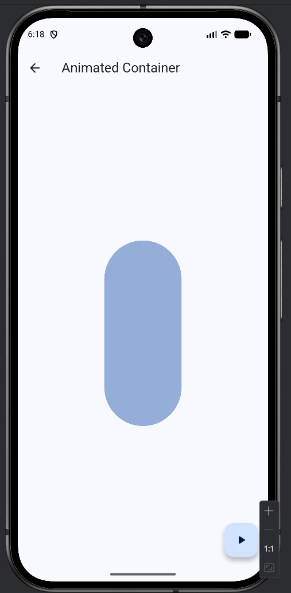<br>**Contenedor animado** | 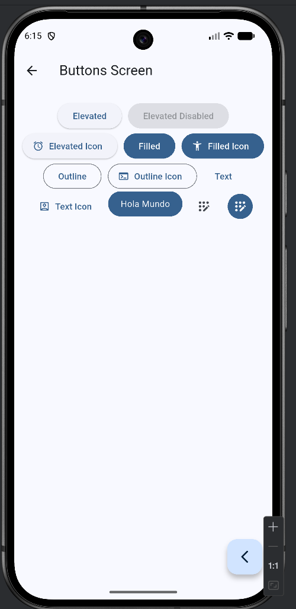<br>**Botones** |
| 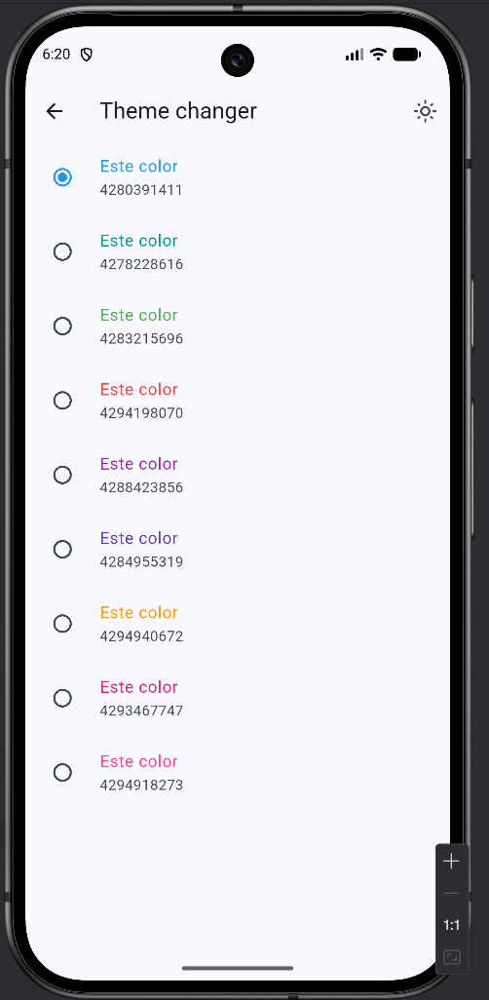<br>**Cambio de tema** | 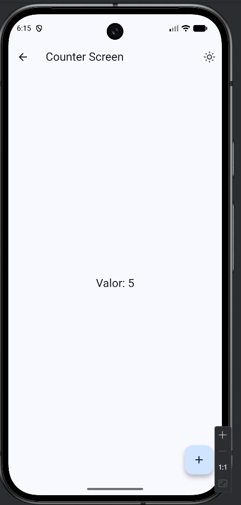<br>**Contador** |
| 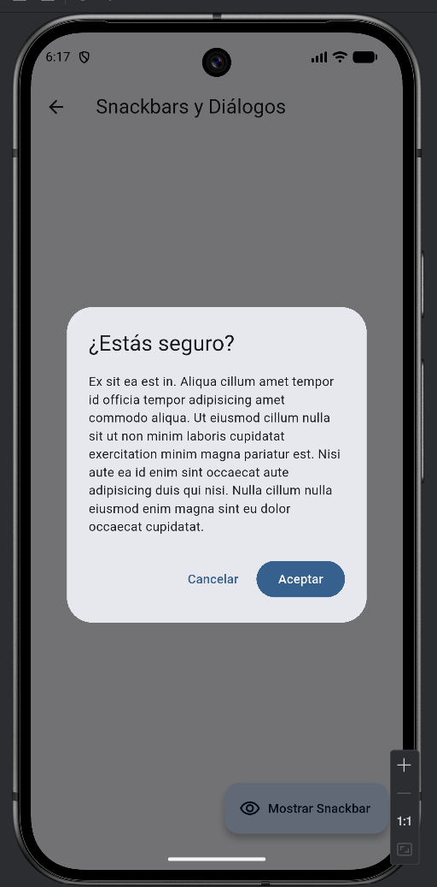<br>**Diálogo** | 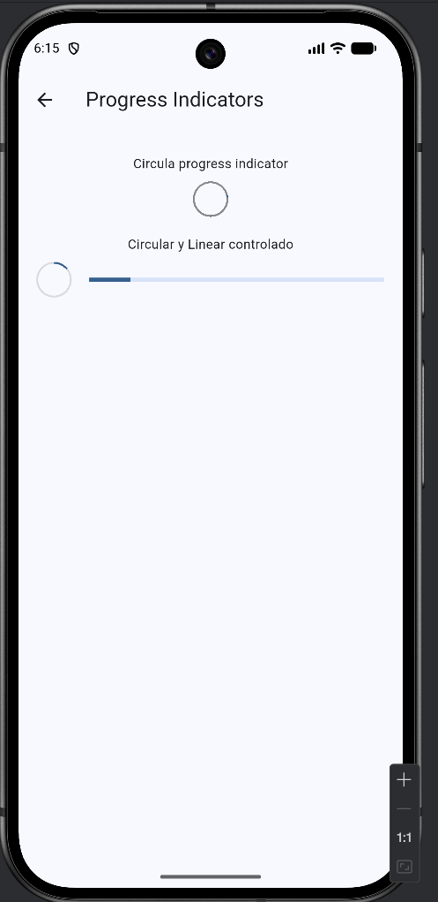<br>**Indicador de progreso** |
| 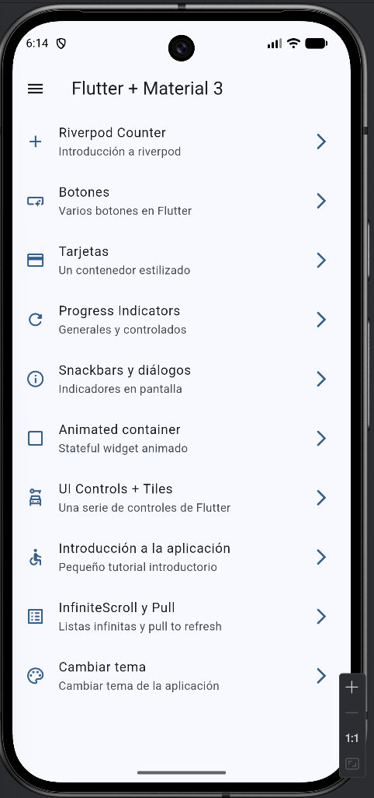<br>**Inicio** | <br>**Introducción** |
| 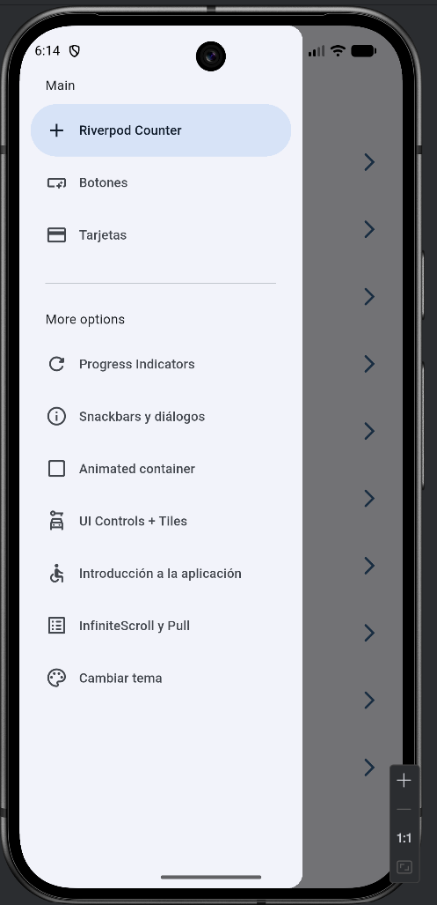<br>**Main** | 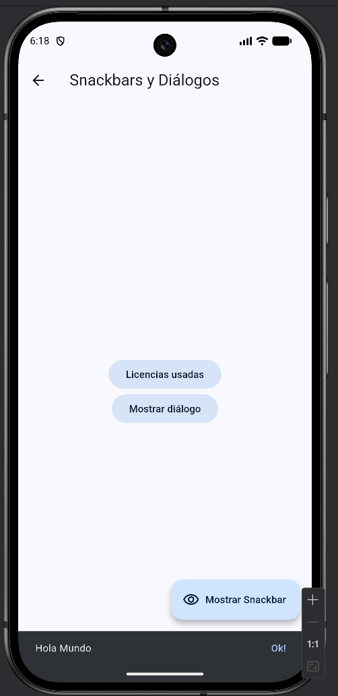<br>**Mostrar snackbar** |
| 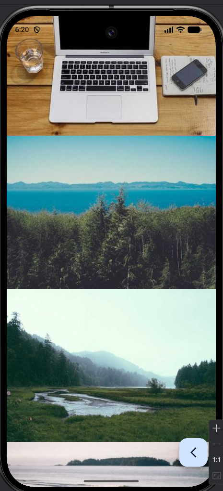<br>**Scroll infinito** | 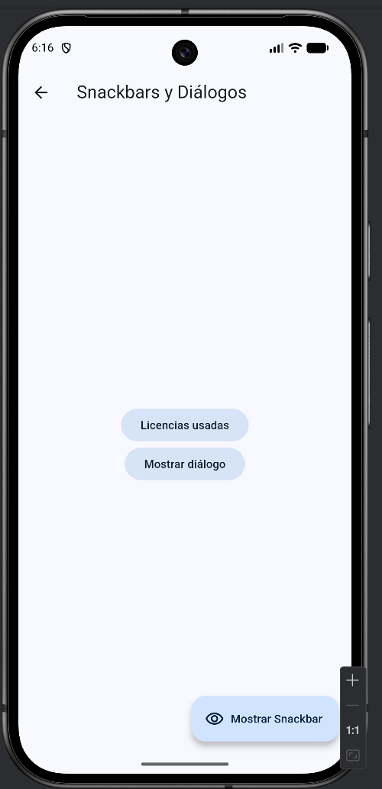<br>**Snackbar** |
| 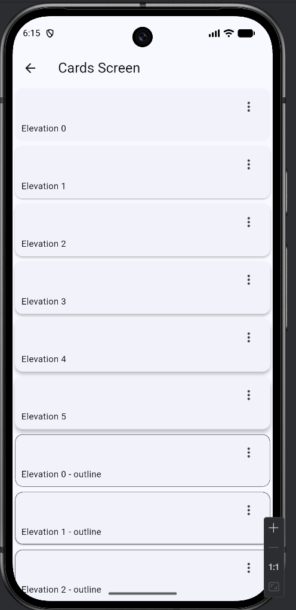<br>**Tarjetas** | 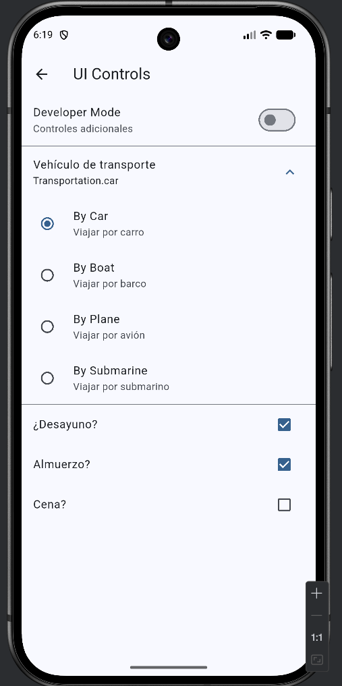<br>**Controles de interfaz** |
| 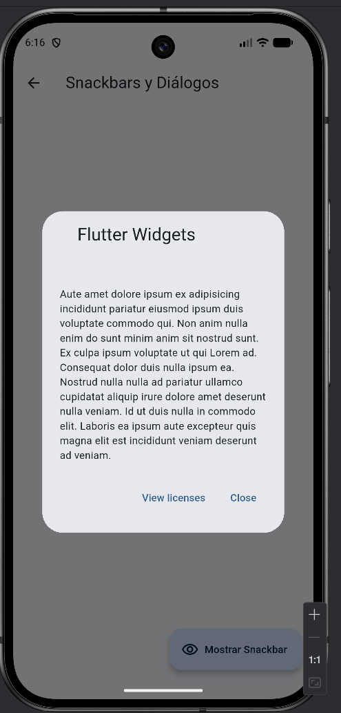<br>**Widgets** | |

## Funcionalidades

- Contador con Riverpod
- Diferentes tipos de botones
- Tarjetas estilizadas
- Indicadores de progreso
- Snackbars y diálogos
- Animated Container
- Controles de interfaz (checkbox, switches, sliders, etc.)
- Tutorial inicial de la aplicación
- Infinite Scroll y pull-to-refresh
- Cambio de tema dinámico

## Tecnologías usadas

- Flutter
- Dart
- Riverpod
- Go Router
- Material 3
- Animate Do

## Requisitos previos

- Flutter SDK 3.0 o superior
- Dart SDK compatible con Flutter 3
- Un editor como VS Code o Android Studio
- Dispositivo emulado o físico para ejecutar la aplicación

## Instalación y ejecución

1. Clona este repositorio o accede a la carpeta del proyecto.
2. Ubícate en la carpeta del proyecto:

```bash
cd Practica05/widgett_app
```

3. Instala las dependencias:

```bash
flutter pub get
```

4. Ejecuta la aplicación:

```bash
flutter run
```

## Estructura del proyecto

```text
lib/
├── config/
│   ├── menu/
│   ├── router/
│   └── theme/
├── presentation/
│   ├── providers/
│   ├── screens/
│   └── widgets/
├── main.dart
└── ...
```

## Navegación

La app cuenta con un menú lateral y rutas definidas para acceder a cada ejemplo de widget. Esto permite explorar las pantallas de una forma ordenada y modular.
