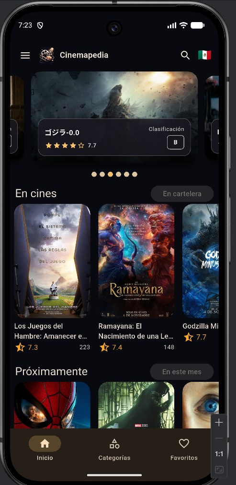
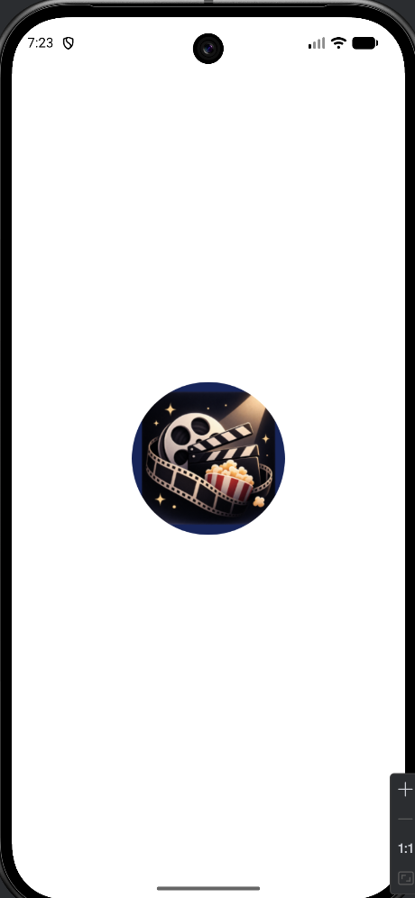
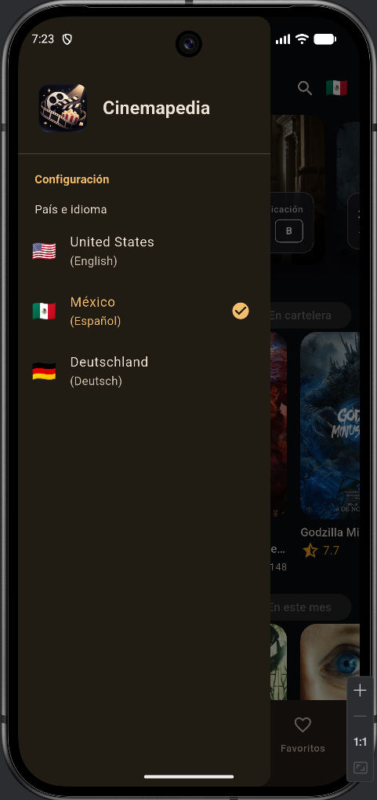
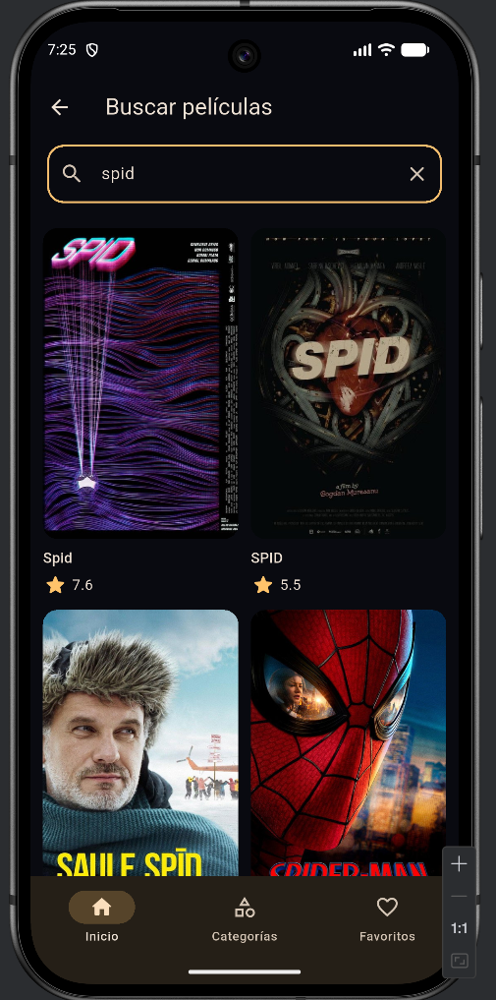
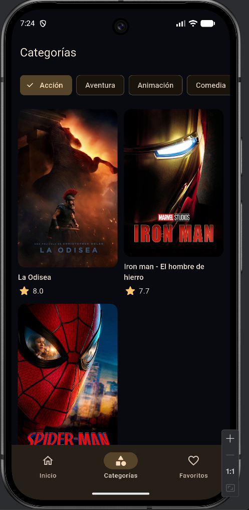
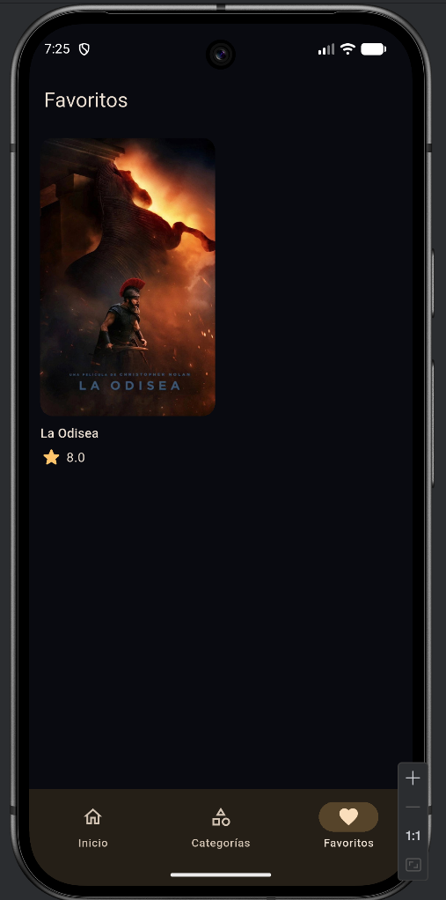
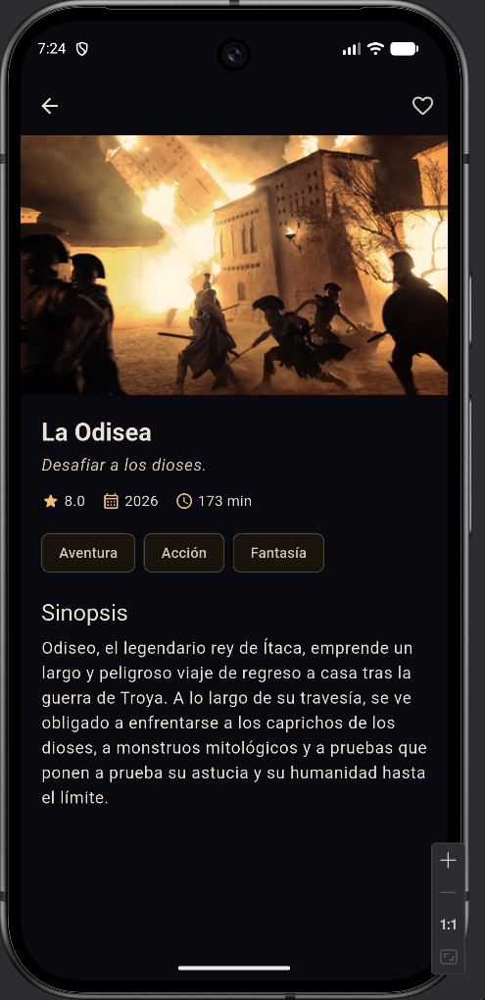

# Cinemapedia

<p align="center">
  
</p>

Cinemapedia es una aplicación multiplataforma desarrollada con Flutter para
descubrir películas y consultar información de The Movie Database (TMDB).

Permite explorar estrenos en cartelera, próximos estrenos, películas populares
y mejor calificadas; buscar títulos; consultar detalles, géneros y reparto;
guardar favoritos y cambiar el idioma y la región de la consulta.

## Links

[Arquitectura](https://artvrolouv.github.io/Practicas_DMI_230629/Practica06/cinemapedia_app/diagrama/cinemapedia_flujo_tmdb.html)


[App en Appetize](https://appetize.io/app/b_d3tadywrvi2rn34o23efcz4ice)


## Funcionalidades

- Catálogo de películas en cartelera.
- Próximos estrenos y películas populares.
- Ranking de películas mejor calificadas.
- Carrusel destacado y listas horizontales.
- Buscador con navegación a los resultados.
- Pantalla de detalle con sinopsis, géneros y calificación.
- Favoritos almacenados en el dispositivo.
- Exploración de películas por categorías.
- Soporte de Estados Unidos, México y Alemania:
  inglés/US, español/MX y alemán/DE.
- Navegación adaptable con Flutter, Riverpod y GoRouter.
- Interfaz preparada para Android, iOS, web, Windows, macOS y Linux.

## Tecnologías

- Flutter y Dart
- Riverpod para el manejo de estado
- GoRouter para navegación declarativa
- Dio para peticiones HTTP
- TMDB API
- SharedPreferences para favoritos locales
- flutter_dotenv para configuración
- Card Swiper y animate_do para presentación visual

## Arquitectura

El proyecto aplica separación por responsabilidades con una arquitectura
por capas:

```text
lib/
├── config/          Configuración, rutas, tema y constantes
├── domain/          Entidades, contratos y repositorios
├── infrastructure/  Cliente HTTP, modelos y mapeadores
└── presentation/    Pantallas, widgets y providers
```

- **Domain:** define las entidades y reglas independientes de la interfaz.
- **Infrastructure:** comunica la aplicación con TMDB y convierte las respuestas.
- **Presentation:** contiene la interfaz y el estado observable de Riverpod.
- **Config:** centraliza rutas, entorno, temas y configuraciones regionales.

## Requisitos

- Flutter SDK compatible con Dart 3.10.4
- Android Studio o Visual Studio Code
- Una cuenta de The Movie Database
- Una clave de API o un token de lectura de TMDB

## Configuración

1. Clona el repositorio:

   ```bash
   git clone https://github.com/ArtvroLouv/Practicas_DMI_230629.git
   cd Practicas_DMI_230629/Practica06/cinemapedia_app
   ```

2. Copia la plantilla de entorno:

   ```bash
   cp .env.template .env
   ```

   En Windows PowerShell:

   ```powershell
   Copy-Item .env.template .env
   ```

3. Reemplaza el valor de ejemplo en `.env`:

   ```env
   THE_MOVIEDB_KEY=tu_clave_de_tmdb
   ```

4. Instala las dependencias:

   ```bash
   flutter pub get
   ```

5. Ejecuta la aplicación:

   ```bash
   flutter run
   ```


## Ejecución por plataforma

```bash
flutter run -d chrome       # Web
flutter run -d windows      # Windows
flutter run -d android      # Android
flutter run -d ios          # iOS
flutter run -d macos        # macOS
flutter run -d linux        # Linux
```

Los dispositivos disponibles se pueden consultar con:

```bash
flutter devices
```

## Icono de la aplicación

El icono oficial se encuentra en:

```text
assets/images/cinemapedia_logo.png
```

Está configurado en `pubspec.yaml` para Android, iOS, web, Windows y macOS.
Para regenerar todos los iconos instalados en las plataformas, ejecuta:

```bash
dart run flutter_launcher_icons
```

## Evidencias de la aplicación

<table>
  <tr>
    <td width="38%">
      
    </td>
    <td width="62%">
      <strong>Pantalla principal</strong><br>
      Presenta el carrusel de películas destacadas, las secciones de estrenos,
      próximos estrenos y navegación entre Inicio, Categorías y Favoritos.
    </td>
  </tr>
  <tr>
    <td>
      
    </td>
    <td>
      <strong>Pantalla de inicio</strong><br>
      Evidencia visual de la pantalla de carga o splash con el icono central
      de Cinemapedia sobre un fondo limpio.
    </td>
  </tr>
  <tr>
    <td>
      
    </td>
    <td>
      <strong>Configuración de país e idioma</strong><br>
      Permite seleccionar Estados Unidos, México o Alemania para actualizar
      el idioma, la región y la información mostrada de las películas.
    </td>
  </tr>
  <tr>
    <td>
      
    </td>
    <td>
      <strong>Buscador de películas</strong><br>
      Muestra los resultados obtenidos al escribir el título o parte del
      nombre de una película, incluyendo póster y calificación.
    </td>
  </tr>
  <tr>
    <td>
      
    </td>
    <td>
      <strong>Categorías</strong><br>
      Permite filtrar y explorar películas por géneros como Acción,
      Aventuras, Animación y Comedia.
    </td>
  </tr>
  <tr>
    <td>
      
    </td>
    <td>
      <strong>Favoritos</strong><br>
      Presenta las películas guardadas localmente por el usuario y conserva
      la información del póster y la calificación.
    </td>
  </tr>
  <tr>
    <td>
      
    </td>
    <td>
      <strong>Información de la película</strong><br>
      Evidencia la pantalla de detalle con imagen principal, título,
      sinopsis, año, duración, calificación, géneros y opción de favorito.
    </td>
  </tr>
  <tr>
    <td>
      
    </td>
    <td>
      <strong>Icono de la aplicación</strong><br>
      Muestra el diseño utilizado como identificador visual de Cinemapedia,
      basado en elementos cinematográficos como carrete, claqueta y palomitas.
    </td>
  </tr>
</table>

## Pruebas y calidad

Desde la carpeta del proyecto:

```bash
flutter analyze
flutter test
```

Las pruebas de widgets se encuentran en `test/widget_test.dart`.

## Compilación

Ejemplos de compilación:

```bash
flutter build apk --release        # Android APK
flutter build appbundle --release  # Android App Bundle
flutter build web --release        # Sitio web
flutter build windows --release    # Aplicación de Windows
```

## Recursos

- [Documentación de Flutter](https://docs.flutter.dev/)
- [Documentación de Riverpod](https://riverpod.dev/)
- [Documentación de GoRouter](https://pub.dev/packages/go_router)
- [Documentación de TMDB](https://developer.themoviedb.org/docs/getting-started)
